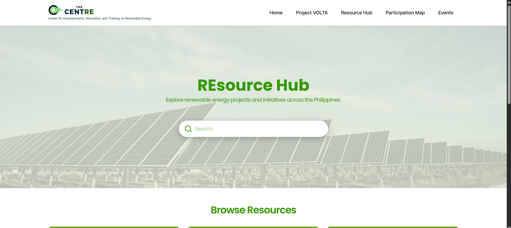
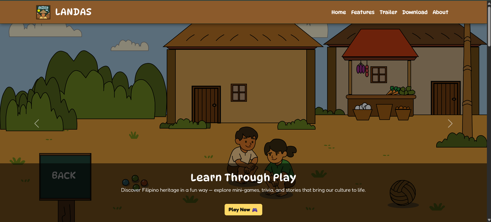

  

  

 

### OPERATIONAL PROTOCOL

 

## ABOUT ME
I’m Joseph, a dreamer and a builder.

I graduated with a BS in Information Technology from PUP Sto. Tomas, Batangas, specializing in front-end development, UI/UX design, and QA.
I love creating interfaces that are visually engaging and intuitive for users. Throughout my four years of university, I developed a versatile 
skill set across web and application development, UI design, and end-to-end project implementation. I am eager to continue growing and turn ambitious ideas into reality.

## TECHNICAL STATS

      
 
      
 
      

## FEATURED PROJECTS

<table>
<tr>
<td width="50%" align="center" valign="top">

The CentRE REsource Hub — <a href="https://thecentre.ph/resource-hub">view live site</a>

<strong>The CentRE REsource Hub </strong> - A centralized platform engineered to streamline media management, event scheduling with automated invitations, and interactive location mapping for seamless public discovery.

</td>
<td width="50%" align="center" valign="top">

LANDAS: 2D Mobile Game — <a href="https://landas2d.github.io/">view live site</a>

<strong>LANDAS: 2D Mobile Game</strong> -A gamified educational mobile app that transforms Philippine history into engaging mini-games, making historical learning fun, interactive, and memorable for students.

</td>
</tr>
</table>

 

## GITHUB STATS

HTML

 

## LET'S WORK TOGETHER

  
  
  
  
  

  

© 2026 Joseph Maliza · Fueled by big dreams, iced coffee, and sheer determination
